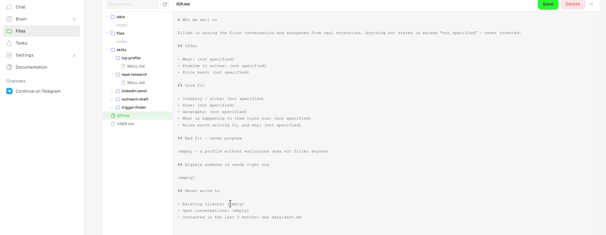

У каждого агента есть **воркспейс** — изолированная файловая среда. Здесь хранятся документы, папки и другие ресурсы, на которые агент может ссылаться: и те, что загружаете вы, и те, что он создаёт в процессе работы.



## Как добавить файлы?

Откройте раздел **Файлы** и:

- загрузите отдельные файлы или целые папки
- создайте папки, чтобы организовать рабочее пространство

Файлы можно также прикрепить прямо в чате — они попадут в воркспейс.

## Что агент умеет делать с файлами?

- Читать документы и отвечать на вопросы по их содержимому
- Извлекать данные из PDF, таблиц и других форматов
- Создавать и редактировать файлы — отчёты, логи, заметки
- Читать документы из Google Диска, если подключена [интеграция](/brain/connectors)

Например, задача по расписанию может каждую пятницу сохранять итоги недели в файл:

```text
Каждую пятницу в 17:00 спроси меня, что было сделано за неделю,
запиши ответ в файл weekly_report_[дата].md.
```

## Где лежат навыки и база знаний?

Служебные файлы агента тоже хранятся в воркспейсе:

| Что | Где |
| --- | --- |
| Навыки | `.agents/skills/` в разделе **Файлы** |
| Ядро базы знаний | IDENTITY.md, SOUL.md, USER.md в **Мозг → База знаний** |
| Справочные документы | **Мозг → База знаний → Документы** |

Это обычные текстовые файлы — их можно открыть и отредактировать напрямую.

## Может ли агент изменять или удалять файлы?

Только если вы это разрешили. Изменение и удаление файлов включаются отдельными переключателями в **Настройки → Разрешения инструментов**. Подробнее — в [Разрешениях и приватности](/settings/permissions).

<Warning>
  При удалении воркспейса все файлы, созданные агентом, удаляются безвозвратно. Сохраните нужное заранее.
</Warning>

## Похожие страницы

- [Сообщения и совместная работа](/agent/chat)
- [База знаний](/brain/knowledge)
- [Навыки](/brain/skills)
- [Разрешения и приватность](/settings/permissions)
- [Настройки и уведомления](/settings/delete-agent)
