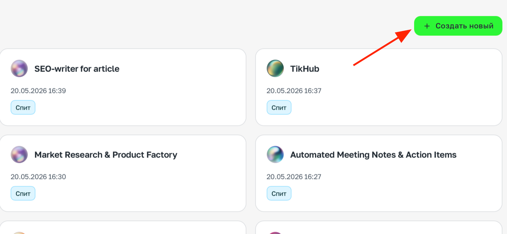
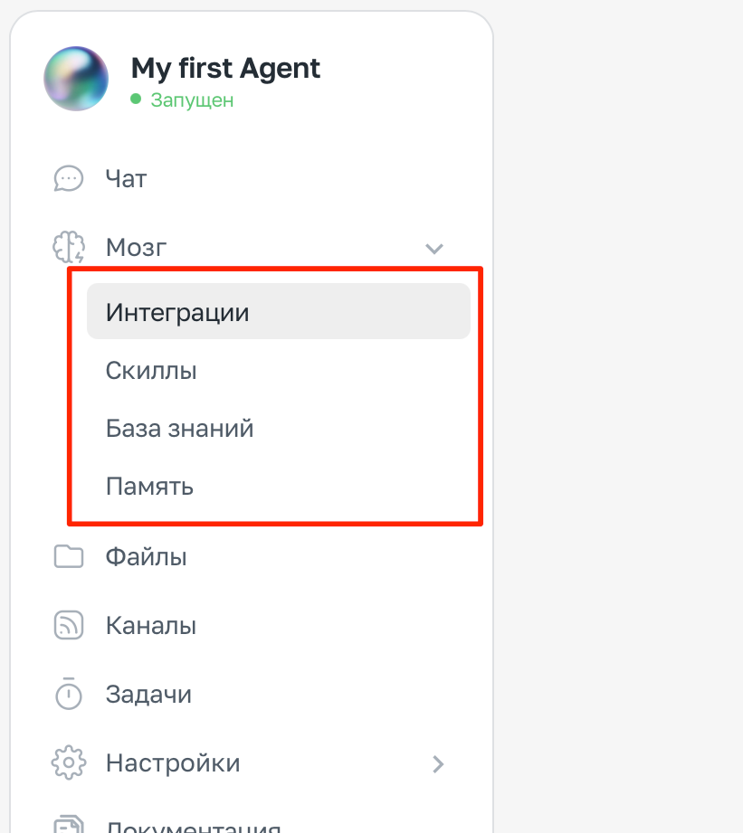

Каждый агент в ASCN — отдельный помощник со своим рабочим пространством, интеграциями, навыками и памятью. Создавайте разных агентов под разные роли: личный помощник, поддержка клиентов, маркетинг, аналитика.

## Как создать агента?

1. Войдите в [ASCN](https://ascn.ai/ru/agent)
2. На главной странице нажмите **\+ Создать новый** в правом верхнем углу
3. Напишите в чате, чем агент должен заниматься

После первого сообщения агент сам предложит подключить нужные сервисы. Пошагово — в [Быстром старте](/getting-started/quickstart).

## Как переключаться между агентами?

Выберите нужного агента в меню слева вверху. У каждого агента свои чаты, задачи, файлы и настройки — данные одного агента недоступны другому.

## Что такое Мозг агента?

**Мозг** — центр управления агентом. Здесь вы задаёте, к чему он подключён, как себя ведёт и что знает о вас и вашей работе.

<Columns cols={2}>
  <Card title="Интеграции" icon="plug" href="/brain/connectors">
    Внешние сервисы: Gmail, Google Календарь, Slack, GitHub. Агент читает данные из них и выполняет действия.
  </Card>

  <Card title="Навыки" icon="bolt" href="/brain/skills">
    Шаблоны поведения для повторяющихся задач. Добавляются из библиотеки или создаются через чат.
  </Card>

  <Card title="Знания" icon="book" href="/brain/knowledge">
    Роль агента, информация о вас, тон общения и справочные документы.
  </Card>

  <Card title="Память" icon="brain" href="/brain/memory">
    То, что агент запомнил в разговорах. Сохраняется между сессиями автоматически.
  </Card>
</Columns>

## В каком порядке настраивать нового агента?

1. **Интеграции** — подключите сервисы, которые нужны для задачи. Например, Gmail и Google Календарь для агента по почте.
2. **Знания** — объясните агенту, кто он, и расскажите о себе. Например: «Ты помощник Alex, менеджера по продажам. Пиши коротко и по делу».
3. **Навыки** — добавьте, если нужна специфическая логика. Например, навык «еженедельный отчёт по сделкам».
4. **Память** — работает автоматически, вмешиваться не нужно.

## Как перезапустить или удалить агента?

Откройте **Настройки → Опасная зона**:

- **Перезапустить** — если агент завис или не отвечает. Данные, настройки и задачи сохраняются.
- **Удалить воркспейс** — полное и необратимое удаление агента со всеми данными.

Подробнее — в [Настройках и уведомлениях](/settings/delete-agent#опасная-зона).

## Можно ли связать нескольких агентов?

Прямой связи между агентами нет. Используйте [API](/settings/api) как мост: один агент отправляет данные другому через API-запрос. У каждого агента свой Base URL и ключ авторизации.

## Похожие страницы

- [Быстрый старт](/getting-started/quickstart)
- [Как работает ASCN Agent](/architecture/overview)
- [Приложения и интеграции](/brain/connectors)
- [Командные агенты](/agent/team-agents)
- [Настройки и уведомления](/settings/delete-agent)
