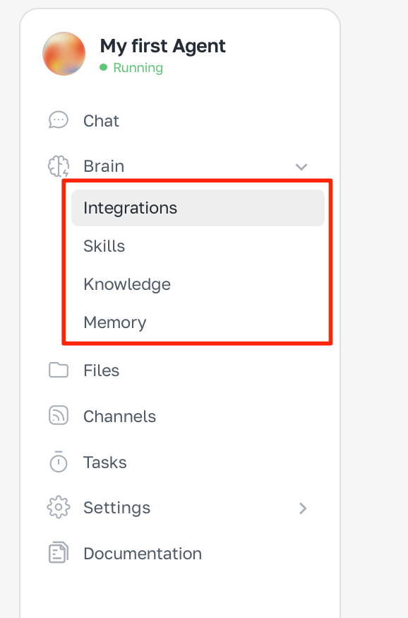

ASCN 中的每个 Agent 都是独立的助手，拥有自己的工作区、集成、技能和记忆。为不同角色创建不同的 Agent：私人助理、客户支持、营销、数据分析。

## 如何创建 Agent？

1. 登录 [ASCN](https://ascn.ai/agent)
2. 在首页点击右上角的 **\+ 新建**
3. 在聊天中写下 Agent 需要做什么

发送第一条消息后，Agent 会建议连接所需的服务。分步说明见[快速入门](/cn/getting-started/quickstart)。

## 如何在 Agent 之间切换？

在左上角菜单中选择 Agent。每个 Agent 都有自己的聊天、任务、文件和设置：一个 Agent 的数据对其他 Agent 不可见。

## 什么是 Agent 的大脑？

**大脑**是 Agent 的控制中心。在这里设置它连接了什么、如何表现，以及它对你和你的工作了解什么。

<Columns cols={2}>
  <Card title="集成" icon="plug" href="/cn/brain/connectors">
    外部服务：Gmail、Google 日历、Slack、GitHub。Agent 从中读取数据并执行操作。
  </Card>

  <Card title="技能" icon="bolt" href="/cn/brain/skills">
    重复任务的行为模式。可从技能库安装，也可在聊天中创建。
  </Card>

  <Card title="知识" icon="book" href="/cn/brain/knowledge">
    Agent 的角色、关于你的信息、语气和参考文档。
  </Card>

  <Card title="记忆" icon="brain" href="/cn/brain/memory">
    Agent 在对话中记住的内容。在会话之间自动保存。
  </Card>
</Columns>

## 新 Agent 按什么顺序配置？

1. **集成**：连接任务所需的服务。例如邮件 Agent 需要 Gmail 和 Google 日历。
2. **知识**：告诉 Agent 它是谁、你是谁。例如：「你是销售经理 Alex 的助理，回答要简洁」。
3. **技能**：需要特定逻辑时添加。例如「每周销售报告」技能。
4. **记忆**：自动工作，无需设置。

## 如何重启或删除 Agent？

打开**设置 → 危险区域**：

- **重启**：Agent 卡住或无响应时使用。数据、设置和任务会保留。
- **删除工作区**：彻底且不可逆地删除 Agent 及其全部数据。

详见[设置和通知](/cn/settings/delete-agent#危险区域)。

## 可以把多个 Agent 连接起来吗？

Agent 之间没有直接连接。可以用 [API](/cn/settings/api) 作为桥梁：一个 Agent 通过 API 请求把数据发给另一个 Agent。每个 Agent 都有自己的 Base URL 和授权密钥。

## 相关页面

- [快速入门](/cn/getting-started/quickstart)
- [ASCN Agent 如何工作](/cn/architecture/overview)
- [应用和集成](/cn/brain/connectors)
- [团队 Agent](/cn/agent/team-agents)
- [设置和通知](/cn/settings/delete-agent)
