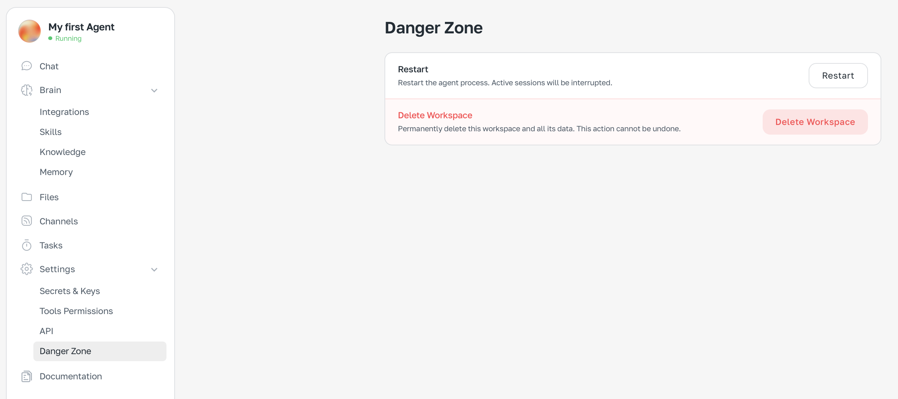

每个 Agent 都有自己的设置。打开 Agent，进入侧边菜单中的**设置**。

## 设置部分

| 部分 | 可配置内容 |
| --- | --- |
| **工具权限** | Agent 是否可以修改和删除工作区中的文件。[详情](/cn/settings/permissions) |
| **密钥和令牌** | 外部服务的令牌和 API 密钥。[详情](/cn/settings/secrets) |
| **API** | 用于程序化访问的 Base URL 和授权密钥。[详情](/cn/settings/api) |
| **危险区域** | 重启 Agent 和删除工作区。[见下文](#危险区域) |

集成、技能、知识和记忆在**大脑**中配置，见[创建和管理 Agent](/cn/brain/overview)。

## 通知

Agent 会把通知发到你与它交流的地方：ASCN 聊天、[Telegram](/cn/channels/telegram) 或 [Slack](/cn/channels/slack)。发送到哪里、何时发送，直接写在任务描述里：

```text
每天 8:00 汇总 Gmail 未读邮件，
并把摘要发到我的 Telegram。
```

<Tip>
  实用做法：为重要邮件设置[触发器](/cn/tasks/triggers)，在 Telegram 即时提醒；其他内容放进[定时](/cn/tasks/scheduled)的晨间摘要。
</Tip>

## 危险区域

**设置 → 危险区域**中有两个操作：重启 Agent 和删除工作区。



### 重启

重启 Agent 进程。所有活动会话会中断，但数据、设置和任务会保留。当 Agent 卡住、行为异常或无响应时使用。

1. 打开**设置 → 危险区域**
2. 点击**重启**

### 删除工作区

彻底且不可逆地删除 Agent。数据无法恢复。

**将被删除的内容：**

- 所有对话和聊天记录
- 大脑设置：集成、技能、知识、记忆
- 任务和触发器
- 已连接的渠道（Telegram 机器人、Slack）
- Agent 创建的文件
- Agent 的密钥和令牌

<Warning>
  删除前请保存需要保留的内容：复制 IDENTITY.md、SOUL.md 和其他知识文件。
</Warning>

**删除方法：**

1. 打开**设置 → 危险区域**
2. 点击**删除工作区**
3. 确认操作

### 删除之外的选择

如果想重新开始但保留部分设置：

- **编辑 IDENTITY.md / SOUL.md**：无需重建即可更新角色和性格
- **停用不再需要的集成**
- **删除特定任务**：在**任务**中操作

只有当你想清除全部历史、从头开始时，才需要彻底删除。

## 相关页面

- [权限和隐私](/cn/settings/permissions)
- [密钥和令牌](/cn/settings/secrets)
- [API](/cn/settings/api)
- [故障排除](/cn/agent/troubleshooting)
