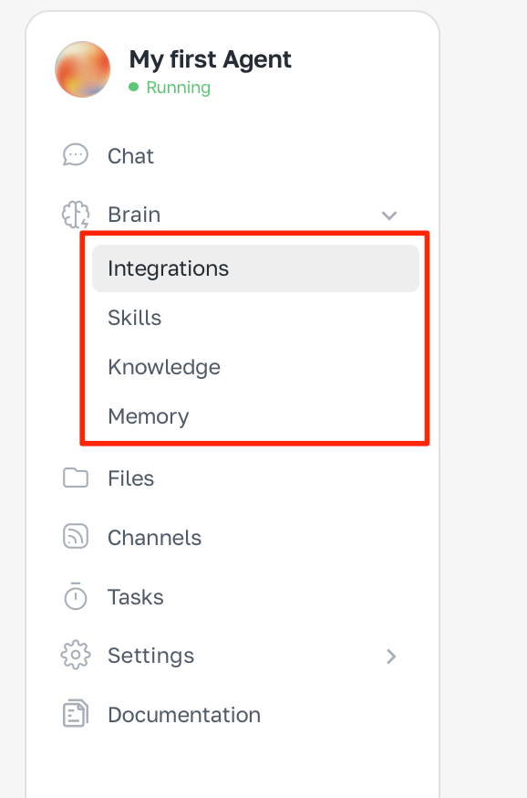

Every agent in ASCN is a separate assistant with its own workspace, integrations, skills and memory. Create different agents for different roles: personal assistant, customer support, marketing, analytics.

## How do I create an agent?

1. Sign in to [ASCN](https://ascn.ai/agent)
2. On the home page, click **\+ Create new** in the top-right corner
3. Tell the agent in chat what it should do

After your first message, the agent offers to connect the services it needs. Step by step — in the [Quickstart](/en/getting-started/quickstart).

## How do I switch between agents?

Pick the agent in the menu at the top left. Each agent has its own chats, tasks, files and settings — one agent's data isn't available to another.

## What is the agent's Brain?

**Brain** is the agent's control center. Here you set what it's connected to, how it behaves, and what it knows about you and your work.

<Columns cols={2}>
  <Card title="Integrations" icon="plug" href="/en/brain/connectors">
    External services: Gmail, Google Calendar, Slack, GitHub. The agent reads data from them and performs actions.
  </Card>

  <Card title="Skills" icon="bolt" href="/en/brain/skills">
    Behaviour patterns for repeated tasks. Install from the library or create in chat.
  </Card>

  <Card title="Knowledge" icon="book" href="/en/brain/knowledge">
    The agent's role, information about you, tone of voice and reference documents.
  </Card>

  <Card title="Memory" icon="brain" href="/en/brain/memory">
    What the agent remembered from conversations. Saved between sessions automatically.
  </Card>
</Columns>

## In what order should I set up a new agent?

1. **Integrations** — connect the services the task needs. For example, Gmail and Google Calendar for an email agent.
2. **Knowledge** — tell the agent who it is and who you are. For example: "You're the assistant of Alex, a sales manager. Keep it short."
3. **Skills** — add them if you need specific logic. For example, a "weekly deals report" skill.
4. **Memory** — works automatically, no setup needed.

## How do I restart or delete an agent?

Open **Settings → Danger zone**:

- **Restart** — if the agent is stuck or unresponsive. Data, settings and tasks are kept.
- **Delete workspace** — complete, irreversible deletion of the agent and all its data.

More in [Settings and notifications](/en/settings/delete-agent#danger-zone).

## Can I connect several agents together?

There's no direct link between agents. Use the [API](/en/settings/api) as a bridge: one agent sends data to another through an API request. Each agent has its own Base URL and authorization key.

## Related pages

- [Quickstart](/en/getting-started/quickstart)
- [How ASCN Agent works](/en/architecture/overview)
- [Apps and integrations](/en/brain/connectors)
- [Team agents](/en/agent/team-agents)
- [Settings and notifications](/en/settings/delete-agent)
