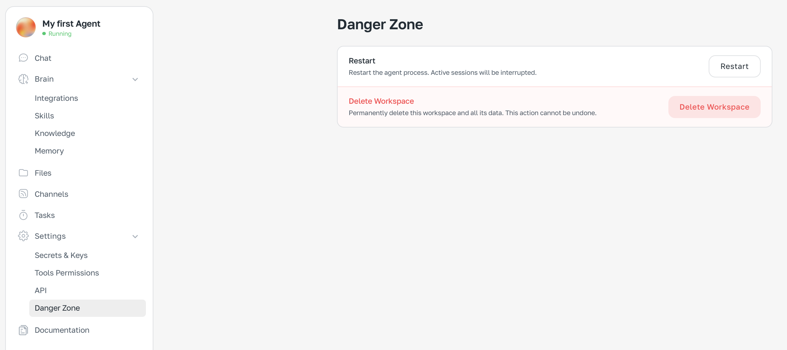

Each agent has its own settings. Open the agent and go to **Settings** in the side menu.

## Settings sections

| Section | What you configure |
| --- | --- |
| **Tool permissions** | Whether the agent can modify and delete files in the workspace. [More](/en/settings/permissions) |
| **Secrets and keys** | Tokens and API keys for external services. [More](/en/settings/secrets) |
| **API** | Base URL and authorization key for programmatic access. [More](/en/settings/api) |
| **Danger zone** | Restarting the agent and deleting the workspace. [Below](#danger-zone) |

Integrations, skills, knowledge and memory live in **Brain** — see [Create and manage agents](/en/brain/overview).

## Notifications

The agent sends notifications wherever you talk to it: ASCN chat, [Telegram](/en/channels/telegram) or [Slack](/en/channels/slack). You set where and when right in the task description:

```text
Every day at 8:00 summarize unread Gmail emails
and send the summary to me in Telegram.
```

<Tip>
  A handy pattern: a [trigger](/en/tasks/triggers) on important emails for instant Telegram alerts, and everything else in a [scheduled](/en/tasks/scheduled) morning summary.
</Tip>

## Danger zone

**Settings → Danger zone** has two actions: restart the agent and delete the workspace.



### Restart

Restarts the agent process. All active sessions are interrupted, but data, settings and tasks remain. Use it if the agent is stuck, behaves unexpectedly or doesn't respond.

1. Open **Settings → Danger zone**
2. Click **Restart**

### Delete workspace

Complete and irreversible deletion of the agent. Data can't be recovered.

**What gets deleted:**

- All conversations and chat history
- Brain settings: integrations, skills, knowledge, memory
- Tasks and triggers
- Connected channels (Telegram bot, Slack)
- Files created by the agent
- The agent's secrets and keys

<Warning>
  Before deleting, save what you want to keep: copy IDENTITY.md, SOUL.md and other knowledge files.
</Warning>

**How to delete:**

1. Open **Settings → Danger zone**
2. Click **Delete workspace**
3. Confirm

### Alternatives to deletion

If you want to start over but keep some settings:

- **Edit IDENTITY.md / SOUL.md** — update the role and character without recreating the agent
- **Disable integrations you no longer need**
- **Delete specific tasks** — in **Tasks**

Full deletion only makes sense if you want to erase all history and start from scratch.

## Related pages

- [Permissions and privacy](/en/settings/permissions)
- [Secrets and keys](/en/settings/secrets)
- [API](/en/settings/api)
- [Troubleshooting](/en/agent/troubleshooting)
