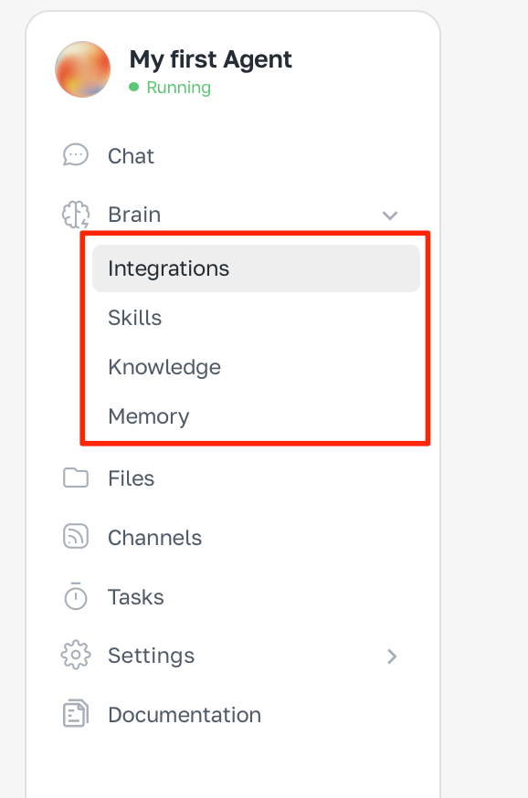

Cada agente en ASCN es un asistente independiente con su propio espacio de trabajo, integraciones, habilidades y memoria. Crea agentes distintos para roles distintos: asistente personal, soporte al cliente, marketing, analítica.

## ¿Cómo creo un agente?

1. Inicia sesión en [ASCN](https://ascn.ai/agent)
2. En la página principal, haz clic en **\+ Crear nuevo** en la esquina superior derecha
3. Escribe en el chat qué debe hacer el agente

Tras el primer mensaje, el agente te propone conectar los servicios necesarios. Paso a paso, en el [Inicio rápido](/es/getting-started/quickstart).

## ¿Cómo cambio de agente?

Elige el agente en el menú de arriba a la izquierda. Cada agente tiene sus propios chats, tareas, archivos y configuración: los datos de un agente no están disponibles para otro.

## ¿Qué es el Cerebro del agente?

**Cerebro** es el centro de control del agente. Aquí defines a qué está conectado, cómo se comporta y qué sabe sobre ti y tu trabajo.

<Columns cols={2}>
  <Card title="Integraciones" icon="plug" href="/es/brain/connectors">
    Servicios externos: Gmail, Google Calendar, Slack, GitHub. El agente lee datos de ellos y realiza acciones.
  </Card>

  <Card title="Habilidades" icon="bolt" href="/es/brain/skills">
    Patrones de comportamiento para tareas repetidas. Desde la biblioteca o creadas en el chat.
  </Card>

  <Card title="Conocimiento" icon="book" href="/es/brain/knowledge">
    El rol del agente, información sobre ti, tono de voz y documentos de referencia.
  </Card>

  <Card title="Memoria" icon="brain" href="/es/brain/memory">
    Lo que el agente recordó de las conversaciones. Se guarda entre sesiones automáticamente.
  </Card>
</Columns>

## ¿En qué orden configuro un agente nuevo?

1. **Integraciones** — conecta los servicios que necesita la tarea. Por ejemplo, Gmail y Google Calendar para un agente de correo.
2. **Conocimiento** — dile al agente quién es y quién eres tú. Por ejemplo: «Eres el asistente de Alex, gerente de ventas. Sé breve».
3. **Habilidades** — añádelas si necesitas lógica específica. Por ejemplo, la habilidad «informe semanal de ventas».
4. **Memoria** — funciona automáticamente, no requiere configuración.

## ¿Cómo reinicio o elimino un agente?

Abre **Configuración → Zona de peligro**:

- **Reiniciar** — si el agente está atascado o no responde. Los datos, la configuración y las tareas se conservan.
- **Eliminar espacio de trabajo** — eliminación completa e irreversible del agente con todos sus datos.

Más en [Configuración y notificaciones](/es/settings/delete-agent#zona-de-peligro).

## ¿Puedo conectar varios agentes entre sí?

No hay conexión directa entre agentes. Usa la [API](/es/settings/api) como puente: un agente envía datos a otro mediante una solicitud a la API. Cada agente tiene su propia Base URL y clave de autorización.

## Páginas relacionadas

- [Inicio rápido](/es/getting-started/quickstart)
- [Cómo funciona ASCN Agent](/es/architecture/overview)
- [Aplicaciones e integraciones](/es/brain/connectors)
- [Agentes de equipo](/es/agent/team-agents)
- [Configuración y notificaciones](/es/settings/delete-agent)
