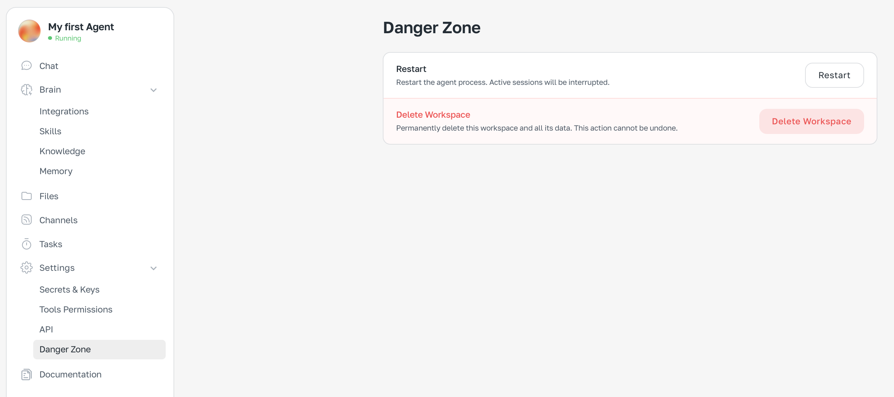

Cada agente tiene su propia configuración. Abre el agente y ve a **Configuración** en el menú lateral.

## Secciones de configuración

| Sección | Qué se configura |
| --- | --- |
| **Permisos de herramientas** | Si el agente puede modificar y eliminar archivos del espacio de trabajo. [Más](/es/settings/permissions) |
| **Secretos y claves** | Tokens y claves de API para servicios externos. [Más](/es/settings/secrets) |
| **API** | Base URL y clave de autorización para acceso programático. [Más](/es/settings/api) |
| **Zona de peligro** | Reiniciar el agente y eliminar el espacio de trabajo. [Abajo](#zona-de-peligro) |

Las integraciones, habilidades, conocimiento y memoria están en **Cerebro**: consulta [Crear y gestionar agentes](/es/brain/overview).

## Notificaciones

El agente envía notificaciones donde hablas con él: chat de ASCN, [Telegram](/es/channels/telegram) o [Slack](/es/channels/slack). Indicas dónde y cuándo en la propia descripción de la tarea:

```text
Cada día a las 8:00 resume los correos no leídos de Gmail
y envíame el resumen a Telegram.
```

<Tip>
  Un patrón útil: un [trigger](/es/tasks/triggers) para correos importantes con aviso inmediato en Telegram, y todo lo demás en un resumen matutino [programado](/es/tasks/scheduled).
</Tip>

## Zona de peligro

**Configuración → Zona de peligro** tiene dos acciones: reiniciar el agente y eliminar el espacio de trabajo.



### Reiniciar

Reinicia el proceso del agente. Todas las sesiones activas se interrumpen, pero los datos, la configuración y las tareas se conservan. Úsalo si el agente está atascado, se comporta de forma inesperada o no responde.

1. Abre **Configuración → Zona de peligro**
2. Haz clic en **Reiniciar**

### Eliminar espacio de trabajo

Eliminación completa e irreversible del agente. Los datos no se pueden recuperar.

**Qué se elimina:**

- Todas las conversaciones e historial de chat
- Configuración del Cerebro: integraciones, habilidades, conocimiento, memoria
- Tareas y triggers
- Canales conectados (bot de Telegram, Slack)
- Archivos creados por el agente
- Secretos y claves del agente

<Warning>
  Antes de eliminar, guarda lo que quieras conservar: copia IDENTITY.md, SOUL.md y otros archivos de conocimiento.
</Warning>

**Cómo eliminar:**

1. Abre **Configuración → Zona de peligro**
2. Haz clic en **Eliminar espacio de trabajo**
3. Confirma

### Alternativas a la eliminación

Si quieres empezar de nuevo pero conservar parte de la configuración:

- **Edita IDENTITY.md / SOUL.md** — actualiza el rol y el carácter sin recrear el agente
- **Deshabilita las integraciones que ya no necesitas**
- **Elimina tareas concretas** — en **Tareas**

La eliminación completa solo tiene sentido si quieres borrar todo el historial y empezar de cero.

## Páginas relacionadas

- [Permisos y privacidad](/es/settings/permissions)
- [Secretos y claves](/es/settings/secrets)
- [API](/es/settings/api)
- [Solución de problemas](/es/agent/troubleshooting)
