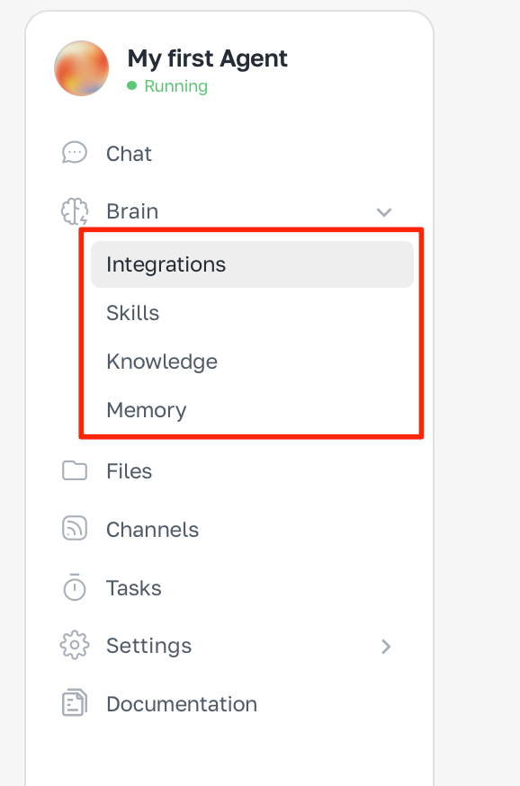

Cada agente no ASCN é um assistente independente com workspace, integrações, habilidades e memória próprios. Crie agentes diferentes para funções diferentes: assistente pessoal, suporte ao cliente, marketing, análise.

## Como crio um agente?

1. Entre no [ASCN](https://ascn.ai/agent)
2. Na página inicial, clique em **\+ Criar novo** no canto superior direito
3. Escreva no chat o que o agente deve fazer

Depois da primeira mensagem, o agente sugere conectar os serviços necessários. Passo a passo no [Início rápido](/pt-BR/getting-started/quickstart).

## Como alterno entre agentes?

Escolha o agente no menu no canto superior esquerdo. Cada agente tem seus próprios chats, tarefas, arquivos e configurações: os dados de um agente não ficam disponíveis para outro.

## O que é o Cérebro do agente?

**Cérebro** é o centro de controle do agente. Aqui você define a que ele está conectado, como se comporta e o que sabe sobre você e seu trabalho.

<Columns cols={2}>
  <Card title="Integrações" icon="plug" href="/pt-BR/brain/connectors">
    Serviços externos: Gmail, Google Agenda, Slack, GitHub. O agente lê dados deles e executa ações.
  </Card>

  <Card title="Habilidades" icon="bolt" href="/pt-BR/brain/skills">
    Padrões de comportamento para tarefas repetidas. Da biblioteca ou criadas no chat.
  </Card>

  <Card title="Conhecimento" icon="book" href="/pt-BR/brain/knowledge">
    A função do agente, informações sobre você, tom de voz e documentos de referência.
  </Card>

  <Card title="Memória" icon="brain" href="/pt-BR/brain/memory">
    O que o agente lembrou das conversas. Salvo entre sessões automaticamente.
  </Card>
</Columns>

## Em que ordem configuro um agente novo?

1. **Integrações** — conecte os serviços de que a tarefa precisa. Por exemplo, Gmail e Google Agenda para um agente de e-mail.
2. **Conhecimento** — diga ao agente quem ele é e quem você é. Por exemplo: «Você é o assistente de Alex, gerente de vendas. Seja breve».
3. **Habilidades** — adicione se precisar de uma lógica específica. Por exemplo, a habilidade «relatório semanal de vendas».
4. **Memória** — funciona automaticamente, sem configuração.

## Como reinicio ou excluo um agente?

Abra **Configurações → Zona de perigo**:

- **Reiniciar** — se o agente travou ou não responde. Dados, configurações e tarefas são mantidos.
- **Excluir workspace** — exclusão completa e irreversível do agente e de todos os dados.

Mais em [Configurações e notificações](/pt-BR/settings/delete-agent#zona-de-perigo).

## Posso conectar vários agentes entre si?

Não há ligação direta entre agentes. Use a [API](/pt-BR/settings/api) como ponte: um agente envia dados a outro por uma requisição à API. Cada agente tem sua própria Base URL e chave de autorização.

## Páginas relacionadas

- [Início rápido](/pt-BR/getting-started/quickstart)
- [Como o ASCN Agent funciona](/pt-BR/architecture/overview)
- [Aplicativos e integrações](/pt-BR/brain/connectors)
- [Agentes de equipe](/pt-BR/agent/team-agents)
- [Configurações e notificações](/pt-BR/settings/delete-agent)
