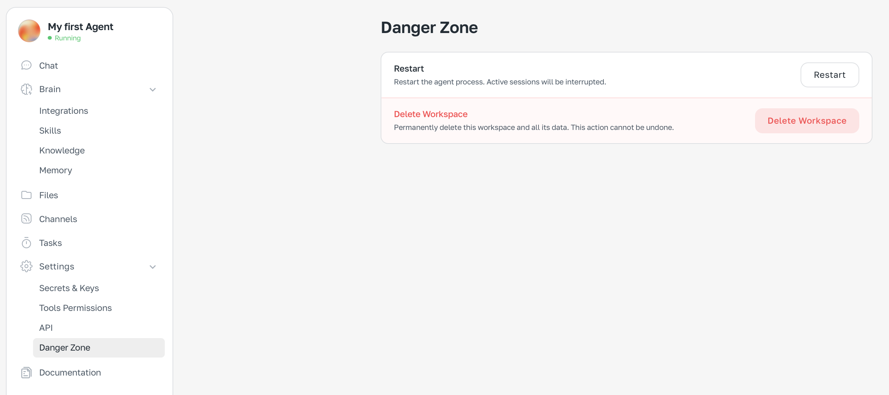

Cada agente tem suas próprias configurações. Abra o agente e vá em **Configurações** no menu lateral.

## Seções de configuração

| Seção | O que se configura |
| --- | --- |
| **Permissões de ferramentas** | Se o agente pode modificar e excluir arquivos do workspace. [Mais](/pt-BR/settings/permissions) |
| **Segredos e chaves** | Tokens e chaves de API para serviços externos. [Mais](/pt-BR/settings/secrets) |
| **API** | Base URL e chave de autorização para acesso programático. [Mais](/pt-BR/settings/api) |
| **Zona de perigo** | Reiniciar o agente e excluir o workspace. [Abaixo](#zona-de-perigo) |

Integrações, habilidades, conhecimento e memória ficam no **Cérebro**: veja [Criar e gerenciar agentes](/pt-BR/brain/overview).

## Notificações

O agente envia notificações onde você conversa com ele: chat do ASCN, [Telegram](/pt-BR/channels/telegram) ou [Slack](/pt-BR/channels/slack). Você define onde e quando na própria descrição da tarefa:

```text
Todo dia às 8:00 resuma os e-mails não lidos do Gmail
e me envie o resumo no Telegram.
```

<Tip>
  Um padrão útil: um [gatilho](/pt-BR/tasks/triggers) para e-mails importantes com aviso imediato no Telegram, e o resto em um resumo matinal [agendado](/pt-BR/tasks/scheduled).
</Tip>

## Zona de perigo

**Configurações → Zona de perigo** tem duas ações: reiniciar o agente e excluir o workspace.



### Reiniciar

Reinicia o processo do agente. Todas as sessões ativas são interrompidas, mas dados, configurações e tarefas são mantidos. Use se o agente travou, se comporta de forma estranha ou não responde.

1. Abra **Configurações → Zona de perigo**
2. Clique em **Reiniciar**

### Excluir workspace

Exclusão completa e irreversível do agente. Os dados não podem ser recuperados.

**O que é excluído:**

- Todas as conversas e o histórico do chat
- Configurações do Cérebro: integrações, habilidades, conhecimento, memória
- Tarefas e gatilhos
- Canais conectados (bot do Telegram, Slack)
- Arquivos criados pelo agente
- Segredos e chaves do agente

<Warning>
  Antes de excluir, salve o que quiser manter: copie IDENTITY.md, SOUL.md e outros arquivos de conhecimento.
</Warning>

**Como excluir:**

1. Abra **Configurações → Zona de perigo**
2. Clique em **Excluir workspace**
3. Confirme

### Alternativas à exclusão

Se quiser recomeçar mas manter parte das configurações:

- **Edite IDENTITY.md / SOUL.md** — atualize a função e o caráter sem recriar o agente
- **Desative as integrações que não usa mais**
- **Exclua tarefas específicas** — em **Tarefas**

A exclusão completa só faz sentido se você quiser apagar todo o histórico e começar do zero.

## Páginas relacionadas

- [Permissões e privacidade](/pt-BR/settings/permissions)
- [Segredos e chaves](/pt-BR/settings/secrets)
- [API](/pt-BR/settings/api)
- [Solução de problemas](/pt-BR/agent/troubleshooting)
