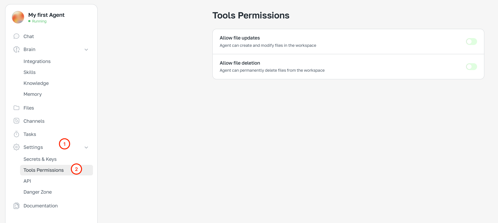

| Permissão | Descrição |
| --- | --- |
| **Permitir alteração** | Criar e editar arquivos |
| **Permitir exclusão** | Exclusão permanente |

<Tip>
  Se o agente não deve alterar arquivos sozinho — desligue «Permitir alteração».
</Tip>
