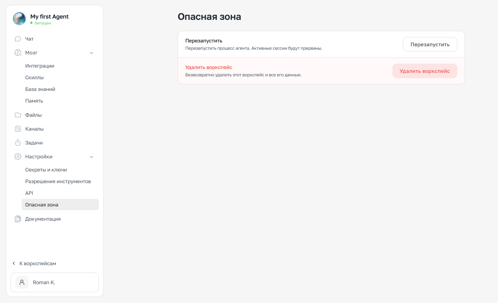

Настройки у каждого агента свои. Откройте агента и перейдите в раздел **Настройки** в боковом меню.

## Разделы настроек

| Раздел | Что там настраивается |
| --- | --- |
| **Разрешения инструментов** | Может ли агент изменять и удалять файлы в воркспейсе. [Подробнее](/settings/permissions) |
| **Секреты и ключи** | Токены и API-ключи для внешних сервисов. [Подробнее](/settings/secrets) |
| **API** | Base URL и ключ авторизации для программного доступа. [Подробнее](/settings/api) |
| **Опасная зона** | Перезапуск агента и удаление воркспейса. [Ниже](#опасная-зона) |

Интеграции, навыки, знания и память настраиваются в разделе **Мозг** — см. [Создание и управление агентами](/brain/overview).

## Уведомления

Агент присылает уведомления туда, где вы с ним общаетесь: в чат ASCN, [Telegram](/channels/telegram) или [Slack](/channels/slack). Куда и когда писать, вы указываете прямо в описании задачи:

```text
Каждый день в 8:00 делай сводку непрочитанных писем в Gmail
и отправляй мне в Telegram.
```

<Tip>
  Удобный паттерн: [триггер](/tasks/triggers) на важные письма — мгновенное уведомление в Telegram, остальное — в утренней [сводке по расписанию](/tasks/scheduled).
</Tip>

## Опасная зона

В разделе **Настройки → Опасная зона** два действия: перезапуск агента и удаление воркспейса.



### Перезапустить

Перезапускает процесс агента. Все активные сессии будут прерваны, но данные, настройки и задачи сохраняются. Используйте, если агент завис, ведёт себя неожиданно или не отвечает.

1. Откройте **Настройки → Опасная зона**
2. Нажмите **Перезапустить**

### Удалить воркспейс

Полное и необратимое удаление агента. Восстановить данные после невозможно.

**Что будет удалено:**

- Все беседы и история чатов
- Настройки Мозга: интеграции, навыки, база знаний, память
- Задачи и триггеры
- Подключённые каналы (Telegram-бот, Slack)
- Файлы, созданные агентом
- Секреты и ключи агента

<Warning>
Перед удалением сохраните всё, что хотите сохранить: скопируйте содержимое IDENTITY.md, SOUL.md и других файлов базы знаний.
</Warning>

**Как удалить:**

1. Откройте **Настройки → Опасная зона**
2. Нажмите **Удалить воркспейс**
3. Подтвердите действие

### Альтернативы удалению

Если хотите начать заново, но сохранить часть настроек:

- **Отредактируйте IDENTITY.md / SOUL.md** — обновите роль и характер без пересоздания
- **Отключите ненужные интеграции** — уберите доступ к сервисам, которые больше не нужны
- **Удалите конкретные задачи** — через раздел **Задачи**

Полное удаление имеет смысл, только если хотите стереть всю историю и начать с чистого листа.

## Похожие страницы

- [Разрешения и приватность](/settings/permissions)
- [Секреты и ключи](/settings/secrets)
- [API](/settings/api)
- [Устранение неполадок](/agent/troubleshooting)
